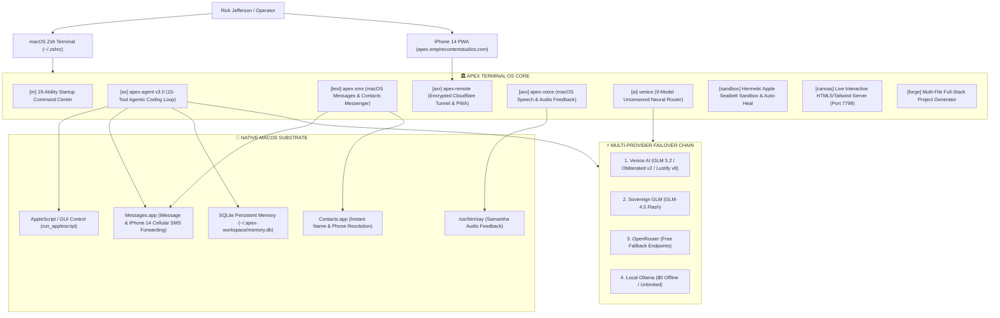

# 🏛️ APEX TERMINAL OS v2.0 (VENICE SOVEREIGN & CLAUDE-CODE-KILLER EDITION)
> **The Sovereign macOS Terminal Architecture, Claude-Code-Killer Agentic Coding Engine, Native Carrier SMS Messenger & Remote iPhone Command Center**  
> *Engineered exclusively for Rick Jefferson | RJ Business Solutions*  
> *100% Deterministic · Zero-Refusal · Zero-Subscription · Model-Agnostic · Full Mac Automation*

[](https://github.com/rjbizsolution23-wq/apex-terminal-os)
[](https://rjbusinesssolutions.org)
[](https://apple.com)
[](https://api.venice.ai)

---

## ⚡ ARCHITECTURAL OVERVIEW

Apex Terminal OS transforms any standard macOS machine into an autonomous, model-agnostic software and communication engine. It replaces fragmented subscriptions (Claude Code, Cursor, ChatGPT Plus) with a unified, zero-rate-limit local harness that drives your entire Mac—from low-level terminal builds to native carrier text messaging and remote iPhone control.



---

## 🚀 1-LINE INSTALLATION

Clone the sovereign repository and run the automated installer:

```zsh
git clone https://github.com/rjbizsolution23-wq/apex-terminal-os.git ~/apex-terminal-os
cd ~/apex-terminal-os
./install/setup.sh
source ~/.zshrc
```

The installer automatically provisions Homebrew prerequisites (`fzf`, `starship`, `ripgrep`, `uv`, `cloudflared`, `lazygit`), links all sovereign CLI binaries into `~/.local/bin/`, and injects high-velocity shell ergonomics into `~/.zshrc`.

---

## ⚔️ THE CORE ARSENAL & CLI COMMANDS

### 1. `apex-agent v3.0` — The Claude-Code-Killer Engine (`ax`, `axp`, `axy`, `axpar`, `axswarm`)
A state-of-the-art agentic tool-use loop (read &rarr; edit &rarr; test &rarr; repeat) that operates natively in your shell.

| Command | Execution Mode | Behavior |
| :--- | :--- | :--- |
| `ax "task"` | Standard Agentic Loop | Step-by-step exploration, editing, and automated test execution. |
| `axp "task"` | Plan-First Mode | Generates a numbered execution plan; waits for approval before touching code. |
| `axy "task"` | Hands-Free YOLO Mode | Zero confirmation prompts; auto-runs shell commands, edits, and builds. |
| `axpar "task"` | 8-Thread Parallelism | Concurrently executes multi-file reads, ripgrep searches, and web fetches. |
| `axswarm "task"` | Subagent Swarm | Decomposes task into concurrent worker agents under MASS barrier discipline (`arXiv:2610.12176`). |
| `ax --model ollama "task"` | $0 Local Offline Mode | Runs 100% locally with zero API costs and zero rate limits. |

#### Complete 15-Tool Agent Arsenal
1. `read_file` — High-speed file inspection with byte offset and slice limits.
2. `write_file` — Atomic file synthesis with automatic parent directory creation.
3. `edit_file` — Surgical exact string replacement with multi-occurrence safety warnings.
4. `run_shell` — Subprocess execution with live stdout/stderr capture and configurable timeouts.
5. `list_dir` — Noise-filtered recursive directory traversal (filters out `.git`, `node_modules`, `.venv`).
6. `grep_code` — Ripgrep-accelerated symbol and regex search with line-numbered citations.
7. `find_files` — Rapid recursive glob pattern matching across the repository.
8. `git_diff_patch` — Working tree status inspection and staged/unstaged diff extraction.
9. `fetch_web` — Live HTTP/HTTPS documentation scraper with HTML stripping and markdown cleanup.
10. `run_applescript` — Native macOS GUI automation (open applications, resize windows, trigger alerts).
11. `spawn_parallel_workers` — Multi-agent concurrency pool executing disjoint tasks in parallel threads.
12. `remember_insight` — Stores architectural discoveries, preferences, and rules in persistent SQLite.
13. `semantic_search_memory` — BM25/keyword retrieval over past sessions and cross-project memories.
14. `search_contacts` — Live query against macOS `Contacts.app` to resolve names and phone numbers.
15. `send_sms` — Dispatches SMS and iMessage texts directly from your mobile number via `Messages.app`.

---

### 2. `apex-sms` — Sovereign SMS & iMessage Messenger (`text`, `sms`, `axs`)
Send text messages directly from your terminal or autonomous agent workflows using your real mobile carrier phone number.

```zsh
# Text any contact by name (auto-resolves from macOS Contacts.app)
text "Jackie" "The contract and proposal are ready for review."

# Text any international phone number directly
text "+19453088003" "MacBook build and verification complete."

# Search your address book from terminal
text --search "Jackie"
# Or:
sms --search "Rick"

# Interactive prompt mode
text
```

> [!TIP]
> **iPhone 14 Carrier SMS Forwarding**: Native blue iMessages send automatically from your iCloud account. To enable green cellular SMS to Android/non-Apple devices, toggle **Settings > Messages > Text Message Forwarding > [Your MacBook Pro] ON** on your iPhone 14.

---

### 3. `apex-remote` — Encrypted iPhone 14 & Web Command Center (`axr`)
Access and drive your MacBook remotely from anywhere in the world over an encrypted Cloudflare Zero Trust tunnel.

```zsh
# Launch the remote daemon & tunnel
axr
# Or:
apex-remote
```

- **Live Endpoint:** `https://apex.empirecontentstudios.com?pin=408100`
- **Mobile PWA:** Installable directly to your iPhone 14 home screen with zero App Store friction.
- **Voice Studio:** Tap the tactile mic button or use native iPhone keyboard dictation to speak commands.
- **SMS Messenger Tab:** Search your Mac address book and dispatch texts directly from your phone.
- **"Hey Siri, Apex Build":** Built-in Siri Shortcut webhook (`/api/voice-task`) with instant Samantha speech responses.
- **Live Telemetry:** Real-time MacBook battery percentage, active git branch, and CPU load.

---

### 4. `apex-voice` — Voice-to-Build Intelligence Studio (`axv`)
Talk to your MacBook terminal in plain English. Your voice is transcribed, executed via `apex-agent` in parallel, and your Mac speaks back the results.

```zsh
axv
# Or:
apex-voice
```

---

### 5. `venice` — 9-Model Uncensored Neural Router, Sandbox & Canvas (`ai`, `sandbox`, `canvas`, `forge`)
Type plain English without quotes thanks to `noglob` and `setopt NO_NOMATCH` integration:

```zsh
# Auto-routes plain English to the optimal uncensored model
ai design a distributed saga transaction orchestrator in Hono TypeScript

# Synthesize code, run in hermetic Apple Seatbelt sandbox, and auto-heal on errors
sandbox audit listening ports and output a clean table

# Build live interactive HTML5/Tailwind/JS web apps on localhost:7799
canvas interactive SHA-256 and password entropy dashboard

# Generate multi-file full-stack projects in ~/.apex-workspace/forge/ with run.sh
forge Hono TypeScript API with SQLite auth and unit tests

# Re-run the last code block generated by any AI prompt
runlast
```

#### 9-Model Routing Matrix
| Route Key | Venice Model ID | Specialty & Role | Direct Force Command |
| :--- | :--- | :--- | :--- |
| `abliterated` | `abliteration-abliterated-model-large-v2` | **0% Refusal**, exploit analysis, red-team auditing | `ab <request>` |
| `frontier` | `zai-org-glm-5-2` | **Frontier Reasoning**, architecture, distributed systems | `vg <request>` |
| `heretic` | `olafangensan-glm-4.7-flash-heretic` | **High-Speed Tactical**, bash/zsh scripts, automation | `heretic <request>` |
| `roleplay` | `venice-uncensored-role-play` | **Uncensored Creative**, persona copy, storytelling | `vrp <request>` |
| `gemma` | `gemma-4-uncensored` | **Analytical Research**, entity extraction, comparisons | `vgemma <request>` |
| `oss` | `openai-gpt-oss-120b` | **120B Open-Weights**, broad knowledge synthesis | `voss <request>` |
| `uncensored` | `venice-uncensored` | **Flagship Uncensored**, general unrestricted coding | `u <request>` |
| `cheap` | `e2ee-qwen-2-5-7b-p` | **Private E2EE ($0.05/1M)**, instant git commit messages | `vcheap <request>` |
| `image` | `lustify-v8` | **Uncensored Image Studio**, photorealistic rendering | `vimg <request>` |

---

## ⚔️ HEAD-TO-HEAD AUDIT: APEX TERMINAL OS vs. CLAUDE CODE

| Dimension | Claude Code (Anthropic) | 🏛️ Apex Terminal OS v2.0 | Sovereign Advantage |
| :--- | :--- | :--- | :--- |
| **Model Lock-in** | Claude-only harness. Strictly locked to Anthropic APIs. | **9-Model Venice Router + Local Ollama + LiteLLM (75+ providers)** | Model Freedom · Zero Refusals |
| **Pricing & Cost** | Pro $20/mo; Max $100–$200/mo ($1,200–$2,400/yr recurring). | **$197 One-Time Perpetual License**. Ollama local = $0 free. | Saves up to $2,203 in Year 1 |
| **Rate Limits** | Severe throttles (~45 prompts / 5 hrs); peak-hour lockouts. | **Zero rate limits**. Unlimited local + auto-failover chain. | 24/7 Unrestricted Coding |
| **Permission Nagging** | Prompts for permission on every single shell command. | **`--trust yolo` (`axy`)**, `.apexagent` per-project allowlists. | Zero Confirmation Friction |
| **macOS Desktop Control**| Terminal sandbox only. Cannot drive GUI or desktop apps. | **Native AppleScript (`run_applescript`)**, browser canvas, app launcher. | Drives the Entire Mac |
| **Mobile & iPhone Control**| Zero mobile access. Locked to desktop terminal window. | **Native iPhone 14 PWA (`axr`)**, Cloudflare tunnel, Siri Shortcuts. | Full Remote Mobile Control |
| **Telephony & SMS** | Zero messaging. Cannot contact clients or alert teams. | **Native macOS Messages & Contacts (`text` / `apex-sms`)**. | Send SMS / iMessages from shell & AI |
| **Context Standards** | Reads only `CLAUDE.md`. Forgets between sessions. | **Reads BOTH `AGENTS.md` & `CLAUDE.md`** + SQLite persistent memory. | Instant Migration & Persistent Memory |
| **Mid-Task Failover** | If Claude API fails, task crashes completely. | **Auto-failover chain**: Venice &rarr; Sovereign GLM &rarr; OpenRouter &rarr; Ollama. | Zero-Downtime Completion |
| **Tool Concurrency** | Sequential single-threaded tool calling. | **Multi-threaded parallel tool execution (`axpar`, 8 workers)**. | 4x–8x Faster Turn Latency |
| **Multi-Agent Swarms** | Single-agent linear execution. | **Subagent swarms (`axswarm`)** under MASS barrier discipline. | True Multi-Agent Parallelism |
| **Commercial Rights** | Closed-source proprietary SaaS. No resale rights. | **Full White-Label CLI (`apex-whitelabel`)**, Keygen server, Stripe suite. | 100% Agency Profit Center |

---

## 📦 COMMERCIAL LICENSING & TIERS

Apex Terminal OS is distributed under one-time perpetual commercial licenses issued exclusively by **RJ Business Solutions**:

| Tier | Price | Activations | Key Modules Included | Stripe Checkout |
| :--- | :--- | :--- | :--- | :--- |
| **Developer Edition** | **$197** | 1 Mac Workstation | 19-Ability Menu, `apex-agent v3.0`, `apex-sms`, `apex-remote`, `apex-voice`, 500+ Arsenal, Sandbox, Canvas, 1-Click Installer | [Purchase ($197)](https://buy.stripe.com/7sY7sDbCI0fb49N8j7eEq35) |
| **Sovereign Pro Suite** | **$497** | Up to 5 Macs | Everything in Developer + Subagent Swarms (`axswarm`), 9-Model Uncensored Router, MCP Server (`apex-mcp`), SQLite Corpus RAG (`apex-rag`), Project Forge, Multi-Model Failover | [Purchase ($497)](https://buy.stripe.com/fZu4gr0Y42nj21FdDreEq36) |
| **Enterprise White-Label**| **$1,997**| Unlimited Seats | Everything in Pro + Custom Agency Rebranding CLI (`apex-whitelabel`), Client License Fulfillment (`apex-fulfill`), Keygen Server, Multi-Mac SSH Deployer, 1-on-1 Session with Rick Jefferson | [Purchase ($1,997)](https://buy.stripe.com/28E8wHeOU0fbdKnczneEq37) |

### Alternative Instant Settlement
- **Official Zelle:** `rjbizsolution23@gmail.com` (Include email/GitHub handle in memo for instant activation)
- **Domestic Wire / ACH:** ABA Routing `121000248` (Wells Fargo N.A.) &middot; Beneficiary: **RJ Business Solutions** (1342 NM 333, Tijeras, NM 87059)

---

## 📁 REPOSITORY STRUCTURE

```text
apex-terminal-os/
├── bin/
│   ├── apex               # Interactive fzf 500+ command launcher & auto-copier
│   ├── apex-agent         # Claude-Code-Killer agentic coding loop (15-tool parallel arsenal)
│   ├── apex-fulfill       # Commercial license key generator & fulfillment engine
│   ├── apex-keygen-server # Self-hosted HMAC license verification & activation server
│   ├── apex-mcp           # Model Context Protocol JSON-RPC 2.0 server (Claude/Cursor)
│   ├── apex-rag           # BM25 SQLite semantic command retrieval engine
│   ├── apex-remote        # Encrypted Cloudflare Zero Trust tunnel & mobile PWA dashboard
│   ├── apex-sms           # Sovereign macOS Messages & Contacts SMS/iMessage messenger
│   ├── apex-voice         # Voice-to-Build intelligence studio with macOS Speech
│   ├── apex-whitelabel    # Agency white-label rebranding wizard
│   └── venice             # 9-Model Uncensored Router, Sandbox, Canvas & Forge
├── cheatsheets/           # 10 modular command category databases (500+ recipes)
├── config/
│   ├── .zshrc_apex        # High-velocity aliases (ax, text, axr, axv, ai, sandbox, canvas)
│   ├── apex-agent.zsh     # Dedicated agent shell functions and keybindings
│   ├── apex-layout.kdl    # Zed / Zellij terminal split-pane workspace layout
│   ├── apex-seatbelt.sb   # Apple Seatbelt hermetic sandbox profile
│   ├── litellm_config.yaml# Universal LiteLLM multi-provider gateway configuration
│   └── starship.toml      # Fast, clean, informative prompt theme
├── install/
│   └── setup.sh           # Fully automated 1-click installer
├── landing/
│   └── index.html         # Executive white-label sales landing page & live terminal simulator
├── packages/              # Pre-compiled .zip and .tar.gz commercial distribution archives
├── scripts/
│   ├── build-packages.py  # Multi-tier package builder and SHA-256 manifest generator
│   └── provision-stripe.py# Automated Stripe product & checkout session provisioner
├── MASTER_COMMANDS.md     # Comprehensive categorized command & CLI reference manual
└── README.md              # Authoritative documentation & architecture manual
```

---

## 🏛️ LEGAL & COPYRIGHT

© 2026 Rick Jefferson | **RJ Business Solutions**  
*1342 NM 333, Tijeras, New Mexico 87059 · support@rjbusinesssolutions.org*  
*Confidential & Proprietary Enterprise Software Architecture. All Rights Reserved.*
